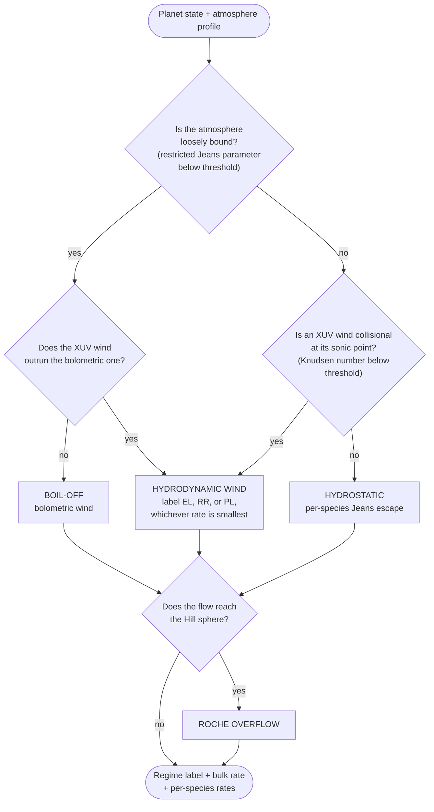

# The ZEPHYRUS model

ZEPHYRUS computes the atmospheric mass loss of rocky and sub-Neptune exoplanets. It runs standalone or as the escape module of the [PROTEUS](https://proteus-framework.org) coupled atmosphere and interior framework, where it is called at every time step with the current planetary state and returns the mass-loss rate that depletes the volatile inventory.

!!! info "Two entry points"
    The escape model of ZEPHYRUS is the regime dispatcher, `zephyrus.dispatch`, which decides which escape physics applies to a state before computing a rate. The older entry point `zephyrus.escape.EL_escape` applies one prescription, the energy-limited rate, to every state without that decision. PROTEUS calls `EL_escape` until its coupling to the dispatcher lands. Energy-limited escape is also one of the dispatcher's regimes, `hydrodynamic:EL`, so the name appears in both places.

Mass loss happens through two physically distinct channels, and ZEPHYRUS models both:

1. **Continuous thermal escape**: the steady outflow or evaporation of the upper atmosphere, driven by stellar irradiation and by the planet's own heat. This is one model with several regimes, described below.
2. **Impact-driven erosion**: the impulsive removal of atmosphere by a single giant collision during accretion, a separate channel with its own prescription (see [giant impacts](impacts.md)).

## Continuous escape: one model, six regimes

Which physics carries the continuous loss depends on how tightly the atmosphere is bound, how strongly it is irradiated, and how collisional its outer layers are. Applying a prescription outside its regime gives rates that are wrong by orders of magnitude, so the dispatcher decides the regime of each atmospheric state before choosing a rate. Every state receives one of six regime labels:

- `boiloff`: the atmosphere is so loosely bound that it flows out on the planet's own thermal energy, faster than stellar XUV heating could drive it. This is typical of young, hot, hydrogen-rich planets fresh out of the nebula. The rate is the isothermal Parker wind of Owen & Wu (2016) [^owenwu] at the wind temperature of Misener et al. (2025) [^misener], and the state is recognised by the restricted Jeans parameter of Fossati et al. (2017) [^fossati].
- `hydrodynamic:EL`: a fluid wind driven by stellar XUV heating, with the rate set by the energy budget (Watson et al. 1981 [^watson], in the tidally corrected form of Erkaev et al. 2007 [^erkaev]). The energy-limited rate is the smallest of the three hydrodynamic limits here.
- `hydrodynamic:RR`: the same fluid wind, with the rate held below the energy limit because the absorbed energy goes into ionisation that recombination re-radiates (the recombination-limited rate of Murray-Clay et al. 2009 [^mc09] is the smallest).
- `hydrodynamic:PL`: the same fluid wind in a well shallow enough that each ionising photon carries more energy than lifting one particle out costs, so the number of photons rather than their energy sets the rate (the photon-limited rate of Owen & Alvarez 2016 [^owenalvarez] is the smallest).
- `hydrostatic`: the gas is too rarefied to sustain a fluid wind, and escape proceeds particle by particle from the exosphere (Jeans escape, with the kinetic enhancement of Volkov et al. 2011 [^volkovb]), species by species, capped by how fast diffusion resupplies each species (Yelle 2024 [^yelle]). Whether the wind is collisional enough to exist is decided by the Knudsen number at its sonic point, after Chatterjee & Pierrehumbert (2026) [^cp26].
- `roche_overflow`: either the tidally driven transfer through the inner Lagrange point (Jackson et al. 2017 [^jackson17]) is the largest rate and is dispatched, or the flow reaches the planet's Hill sphere and the label replaces that of the regime that produced the rate, which is then a lower limit (the overflow geometries of Owen & Jackson 2012 [^oj12]). `diagnostics['roche']['rate_branch']` says which reading applies.

The logic reduces to four questions:

The figure shows the logic, not the full machinery. Each branch carries its own rate physics, limits, and checks, and three refinements are left out: an unstable exosphere lets the wind rate compete with the Jeans rate, a setting can let the bolometric wind compete after boil-off ends, and the transfer through L1 competes wherever it applies, taking the overflow label with its own rate when it wins. The [escape regimes](regimes.md) section walks through every step with its equations and thresholds, and its admission table is the reference for the routing.

The regime boundaries are not sharp lines in nature. Each threshold carries a physical band: the collisionality threshold spans a factor of 30 across heating geometries, and the boil-off threshold a factor of about two across the literature. Beside every verdict, ZEPHYRUS reports how close the state sat to each boundary and what the label would have been at the edges of the band.

Whichever regime sets the bulk rate, the loss is also split over chemical species. Hydrodynamic winds fractionate: heavy species lag the outflow through diffusive drag and can drop out of it entirely, which the N-species closure of the [fractionation](fractionation.md) page resolves (Attia & Lichtenberg 2026 [^attia]). The other regimes split the rate by reservoir mass fractions, and the hydrostatic regime is natively per-species.

## The energy-limited entry point

`zephyrus.escape.EL_escape` is the energy-limited rate on its own, with its two radius scalings and its tidal correction, defined on the [energy-limited escape](energy_limited.md) page. It does not check whether the state sustains a collisional XUV wind, which is the regime where the rate applies and which dominates the loss during roughly the first $10^6$ to $10^8$ years of a close-in planet's life. It is the entry point PROTEUS calls today, and a standalone study that wants one prescription applied everywhere can use it.

## The impact channel

A giant collision removes part of the target's atmosphere in a single event, on a timescale unrelated to the continuous escape. ZEPHYRUS computes the eroded fraction with the scaling law of Kegerreis et al. (2020) [^kegerreis] for thin atmospheres or that of Roche et al. (2026) [^roche2026] for envelopes of 1% to 20% of the planet mass, selected through `zephyrus.collision.impact_loss`. The [giant impacts](impacts.md) page defines both laws and their fitted domains. The impact channel is not part of the continuous regimes: a label is reserved for it, and the caller applies impact erosion as a discrete event.

## Reading guide

- [Escape regimes](regimes.md): how the dispatcher chooses a rate, the notation, and one page per regime with its equations, thresholds, and bands.
- [Dispatching a regime](../Tutorials/dispatch.md): the dispatcher driven end to end on synthetic atmospheres, boundary crossings included.
- [Fractionation](fractionation.md): how a wind splits over species, and when heavy species drop out.
- [Energy-limited escape](energy_limited.md): the single-prescription entry point, its radius scaling, and its tidal correction.
- [Giant impacts](impacts.md): the erosion scaling laws and their fitted domains.
- [Coupling to PROTEUS](proteus.md): configuration keys, the per-time-step sequence, and reservoir bookkeeping.
- [Limitations](limitations.md): what each entry point does not model, and what that implies for results.
- [Troubleshooting the dispatcher](../How-to/troubleshooting.md): what to look at when a flag fires or a label surprises you.
- [Parameter reference](../Reference/parameters.md), [dispatch results](../Reference/results.md), and [API reference](../Reference/api/index.md).

[^owenwu]: Owen, J. E., & Wu, Y. (2016). Atmospheres of low-mass planets: the "boil-off". *The Astrophysical Journal, 817*(2), 107.

[^misener]: Misener, W., et al. (2025). Blowin' in the Nonisothermal Wind: Core-powered Mass Loss with Hydrodynamic Radiative Transfer. *The Astrophysical Journal, 980*(1), 152.

[^fossati]: Fossati, L., et al. (2017). Aeronomical constraints to the minimum mass and maximum radius of hot low-mass planets. *Astronomy & Astrophysics, 598*, A90.

[^watson]: Watson, A. J., Donahue, T. M., & Walker, J. C. G. (1981). The dynamics of a rapidly escaping atmosphere: applications to the evolution of Earth and Venus. *Icarus, 48*(2), 150–166. https://doi.org/10.1016/0019-1035(81)90101-9

[^erkaev]: Erkaev, N. V., Kulikov, Y. N., Lammer, H., et al. (2007). Roche lobe effects on the atmospheric loss from "Hot Jupiters". *Astronomy & Astrophysics, 472*(1), 329–334. https://doi.org/10.1051/0004-6361:20066929

[^mc09]: Murray-Clay, R. A., Chiang, E. I., & Murray, N. (2009). Atmospheric Escape From Hot Jupiters. *The Astrophysical Journal, 693*(1), 23–42. https://doi.org/10.1088/0004-637X/693/1/23

[^owenalvarez]: Owen, J. E., & Alvarez, M. A. (2016). UV Driven Evaporation of Close-in Planets: Energy-limited, Recombination-limited, and Photon-limited Flows. *The Astrophysical Journal, 816*(1), 34. https://doi.org/10.3847/0004-637X/816/1/34

[^volkovb]: Volkov, A. N., Tucker, O. J., Erwin, J. T., & Johnson, R. E. (2011). Kinetic simulations of thermal escape from a single component atmosphere. *Physics of Fluids, 23*(6), 066601. https://doi.org/10.1063/1.3592253

[^yelle]: Yelle, R. V. (2024). Diffusion limited escape of hydrogen from Mars. *Icarus, 416*, 116099.

[^cp26]: Chatterjee, R. D., & Pierrehumbert, R. T. (2026). Novel Physics of Escaping Secondary Atmospheres May Shape the Cosmic Shoreline. *The Astrophysical Journal, 998*(2), 236. https://doi.org/10.3847/1538-4357/ae2ffa

[^jackson17]: Jackson, B., Arras, P., Penev, K., Peacock, S., & Marchant, P. (2017). A new model of Roche lobe overflow for short-period gaseous planets and binary stars. *The Astrophysical Journal, 835*(2), 145. https://doi.org/10.3847/1538-4357/835/2/145

[^oj12]: Owen, J. E., & Jackson, A. P. (2012). Planetary evaporation by UV and X-ray radiation: basic hydrodynamics. *Monthly Notices of the Royal Astronomical Society, 425*(4), 2931. https://doi.org/10.1111/j.1365-2966.2012.21481.x

[^attia]: Attia, M., & Lichtenberg, T. (2026). Atmospheric escape fractionates secondary but not primary atmospheres. *arXiv e-prints*, arXiv:2608.30106. https://doi.org/10.48550/arXiv.2608.30106

[^kegerreis]: Kegerreis, J. A., Eke, V. R., Catling, D. C., Massey, R. J., Teodoro, L. F. A., & Zahnle, K. J. (2020). Atmospheric Erosion by Giant Impacts onto Terrestrial Planets: A Scaling Law for any Speed, Angle, Mass, and Density. *The Astrophysical Journal Letters, 901*(2), L31. https://doi.org/10.3847/2041-8213/abb5fb

[^roche2026]: Roche, M. J., Lock, S. J., Carter, P. J., & Leinhardt, Z. M. (2026). Giant impacts preferentially remove low-mass atmospheres: a generalised scaling law for impact-driven atmospheric loss. *The Astrophysical Journal Letters* (accepted), arXiv:2610.06077. https://doi.org/10.48550/arXiv.2610.06077. Dataset: Zenodo, https://doi.org/10.5281/zenodo.23192423.
