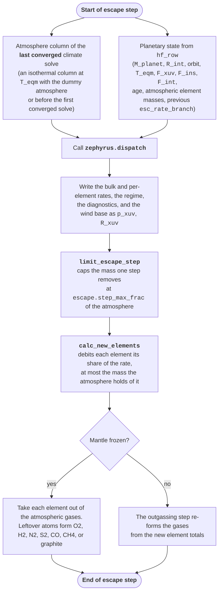

# ZEPHYRUS in PROTEUS

This page describes how ZEPHYRUS is wired into the PROTEUS framework as its atmospheric escape module. The coupling code is in the PROTEUS [escape wrapper](https://github.com/FormingWorlds/PROTEUS/blob/main/src/proteus/escape/wrapper.py) and the [dispatcher coupling](https://github.com/FormingWorlds/PROTEUS/blob/main/src/proteus/escape/dispatcher.py). For the model itself, see [the ZEPHYRUS model](model.md) and the [escape regimes](regimes.md). For the standalone API, see the [API reference](../Reference/api/index.md).

PROTEUS calls ZEPHYRUS in one of two schemes, set by `escape.zephyrus.scheme`. The default, `"dispatcher"`, calls `zephyrus.dispatch`, which decides the escape regime of each state and returns a rate for each element. `"el"` calls `EL_escape`, energy-limited escape alone, and splits the bulk rate over the elements by abundance. Configs that must reproduce results computed before the dispatcher, such as the CHILI intercomparison cases, select `"el"`.

---

## Selecting an escape module

PROTEUS exposes four escape backends, selected by `config.escape.module`:

| `module` | Behaviour |
|---|---|
| `"none"` | Escape disabled. Bulk rate is set to zero and per-element rates are zeroed. |
| `"dummy"` | Fixed user-specified bulk rate from `config.escape.dummy.rate`. Always unfractionating. |
| `"zephyrus"` | Calls `zephyrus.dispatch` (`scheme = "dispatcher"`, the default) or `zephyrus.escape.EL_escape` (`scheme = "el"`). |
| `"boreas"` | Calls the separate BOREAS module (no longer actively used). |

Any other value raises `ValueError` at the top of `proteus.escape.wrapper.run_escape`.

---

## Configuring the ZEPHYRUS module

The PROTEUS configuration block for ZEPHYRUS lives under `[escape]` and `[escape.zephyrus]` in the input config file. Most settings of the dispatcher have a key of the same name, with pressures in bar, and unset they take the ZEPHYRUS defaults listed on the [parameter reference](../Reference/parameters.md). The exceptions: the prescribed exobase temperature is `T_exo` (`T_exo_value` in ZEPHYRUS), the fixed-pressure wind base is `Pxuv` (`P_base_fixed`), the photospheric opacity `kappa_photo`, an input of each ZEPHYRUS call, is a PROTEUS setting, and `gamma_bates` and `gamma_wind` keep their ZEPHYRUS values. The most used ones:

```toml
[escape]
    module     = "zephyrus"

    [escape.zephyrus]
        scheme      = "dispatcher"  # "dispatcher" or "el"
        efficiency  = 0.1           # heating efficiency of the energy-limited rate
        T_exo       = 1000.0        # prescribed exobase temperature [K]
        P_photo     = 0.02          # photospheric level [bar]
        kappa_photo = 1e-2          # grey photospheric opacity [m2 kg-1]
        base_method = "lopez"       # wind base: "lopez" or "fixed_pressure" (at Pxuv)
```

| Key | Type | Units | Description |
|---|---|---|---|
| `escape.zephyrus.scheme` | str | - | `"dispatcher"` or `"el"`. |
| `escape.reservoir` | str | - | Composition of the escaping gas. Unset, it is `"pxuv"` under the dispatcher and `"outgas"` under `"el"`. See [Reservoir](#reservoir) below. |
| `escape.zephyrus.tidal` | bool | - | Tidal reduction $K_\mathrm{tide}$ of the escape barrier. Unset, it is on under the dispatcher and off under `"el"`. |
| `escape.hill_clamp` | bool | - | Clip the XUV radius at the Hill radius. Unset, it is off under the dispatcher, whose Roche screen and L1 overflow rate treat that geometry, and on under `"el"`. |
| `escape.zephyrus.efficiency` | float | - | Heating efficiency $\epsilon$ of the energy-limited rate. Zero is allowed under `"el"` only. |
| `escape.zephyrus.Pxuv` | float | bar | XUV level of `"el"`, read by the atmosphere module to find $R_\mathrm{XUV}$. Under the dispatcher it is the wind base of `base_method = "fixed_pressure"`. |
| `escape.zephyrus.P_photo` | float | bar | Photospheric level of the dispatcher: the radius of its energy-limited rate and the boil-off launch level. |
| `escape.zephyrus.kappa_photo` | float | m$^2$ kg$^{-1}$ | Grey photospheric opacity of the boil-off rate. PROTEUS passes this constant, not an opacity from its atmosphere model. |
| `escape.zephyrus.T_exo` | float | K | Exobase temperature of the hydrostatic branch when `T_exo_mode = "prescribed"`. |

PROTEUS checks the whole block with `DispatchSettings.validate` when the config loads, so a value the dispatcher refuses fails at load and names the key.

---

## At each PROTEUS time step



The climate step runs after escape in the PROTEUS loop, so escape at step $n$ reads the column solved at step $n - 1$, as the energy-limited scheme reads $R_\mathrm{XUV}$. A rejected climate solve leaves the column of the last converged one in place. The branch that set the previous rate (`esc_rate_branch`) is passed back as the hysteresis memory of the Knudsen switch, so an evolving track does not alternate between the hydrodynamic and hydrostatic branches. On the first escape step, and on resume from a helpfile without the column, the switch is sharp.

PROTEUS passes the interior heat flux `F_int`, floored at 10$^{-10}$ W m$^{-2}$. The dispatcher reads it only for the bolometric rate past the boil-off threshold, which is off by default (`residual_mode = "off"`).

!!! info "A frozen mantle"
    While the mantle is molten, the outgassing step that follows escape re-forms the atmospheric gases from the element totals. Once it has solidified, no step does, so PROTEUS takes each escaping element out of the gases that hold it. Each gas loses the smallest retained fraction among its elements. Oxygen, hydrogen, nitrogen, and sulfur left over form O2, H2, N2, and S2. Leftover carbon pairs with oxygen into CO, then with hydrogen into CH4, and otherwise condenses as graphite. Water that loses its hydrogen therefore leaves O2 behind. Rock vapours keep their masses, so the step cap and the escaping shares count only the elements the gases can lose.

---

## Reservoir

`config.escape.reservoir` sets the composition of the escaping gas:

| `reservoir` | Description |
|---|---|
| `"pxuv"` | The per-element rates of the dispatcher, set by the composition at the wind base and the diffusion closure. The atmosphere is the reservoir. Requires the dispatcher, and is its only reservoir. |
| `"outgas"` | Element mass fractions of the atmosphere. `"el"` and the dummy module only. |
| `"bulk"` | Element mass fractions of the whole planet. `"el"` and the dummy module only. |

Any other string raises `ValueError`. After the loss step, inventories that fall below `config.outgas.mass_thresh` are zeroed out while the mantle is molten.

---

## Helpfile fields written by ZEPHYRUS

| Field | Units | Source |
|---|---|---|
| `esc_rate_total` | kg s$^{-1}$ | Bulk rate |
| `esc_rate_{e}` | kg s$^{-1}$ | One per element. Under the dispatcher these are its per-element rates, which sum to the bulk rate |
| `esc_regime` | - | Regime label as a code: 1 `boiloff`, 2 `hydrodynamic:EL`, 3 `hydrodynamic:RR`, 4 `hydrodynamic:PL`, 5 `hydrostatic`, 6 `roche_overflow`, 0 not set |
| `esc_rate_branch` | - | Code of the branch that set the rate: the producing branch under a geometric Roche relabel, `roche_overflow` when the L1 transfer wins, 0 not set |
| `esc_kn_sonic` | - | Knudsen number at the sonic point, -1 when not evaluated |
| `esc_lambda` | - | Restricted Jeans parameter of the boil-off test, -1 when not evaluated |
| `esc_T_exo` | K | Exobase temperature of the hydrostatic branch, -1 when not evaluated |
| `esc_T_esc_neutral`, `esc_T_esc_plasma` | K | Neutral and plasma escape temperatures at the exobase, -1 when not evaluated |
| `esc_f_ion_exo` | - | Ionisation fraction at the exobase, -1 when not evaluated |
| `esc_base_clamp_dex` | - | Decades between the wind base and the profile level used, when the base lay outside the profile, 0 otherwise |
| `esc_profile_source` | - | Column read: 1 the latest solve, 2 an earlier converged solve, 3 an isothermal column, 0 not set |
| `p_xuv`, `R_xuv` | bar, m | Wind base under the dispatcher. Under `"el"`, `p_xuv` is `Pxuv` and `R_xuv` is re-populated by the atmosphere module |
| `{e}_kg_total` | kg | Updated by `calc_new_elements` after time-integrating the loss over `dt` |

The dispatcher flags of each step are written to the PROTEUS log.

---

## The energy-limited scheme

With `scheme = "el"`, PROTEUS calls `EL_escape` with the tidal flag, the orbit, `M_planet`, the stellar mass, `efficiency`, `R_int`, the $R_\mathrm{XUV}$ the atmosphere module found at `Pxuv`, and `F_xuv`. It then distributes the bulk rate over the elements by mass fraction in the reservoir (`calc_unfract_fluxes`), so light and heavy elements are not separated in the outflow.

!!! note "`scaling=3` is hard-coded"
    The PROTEUS wrapper calls `EL_escape` with `scaling=3`, the $R_\mathrm{XUV}^3$ form. This is not exposed as a config option. The dispatcher uses $R_p R_\mathrm{XUV}^2$ (`scaling=2`, the function default) with $R_\mathrm{XUV}$ at `P_photo`.

!!! info "Oxygen"
    Oxygen is debited like every other element. The outgassing module can reset `O_kg_total` on its next call, because the prescribed mantle redox state (`outgas.fO2_shift_IW`) sets it.

The lid seal of PROTEUS (`outgas.lid_seal`) requires an unfractionated reservoir, and so this scheme with ZEPHYRUS, because a held step scales the atmosphere uniformly.

---

## Termination on atmosphere loss

PROTEUS can be configured to terminate a run when the surface pressure drops below a threshold, regardless of which escape module is in use:

```toml
[params.stop.escape]
    enabled = true
    p_stop  = 5.0       # Stop when surface pressure drops below this value [bar]
```

This works the same way for ZEPHYRUS, dummy, and BOREAS backends.

---

## Giant-impact atmosphere loss

Alongside the continuous escape channel above, ZEPHYRUS provides `collision.impact_loss`, which evaluates one of the two giant-impact erosion laws described on the [giant impacts](impacts.md) page: Kegerreis et al. (2020)[^cite-kegerreis2020] for thin atmospheres and Roche et al. (2026)[^cite-roche2026] for envelopes of 1% to 20% of the planet mass. It is a standalone function of the collision parameters and returns the fraction of the target's atmosphere removed by one impact, for a caller that models giant impacts during accretion. Under both laws the speed is taken at first contact, and the masses and radii exclude the atmosphere, with radii at its base. The Kegerreis law also takes the bulk densities of the atmosphere-free bodies, and the Roche law the target's atmospheric mass fraction.

---

## Caveats

!!! warning "Unit handling at the wrapper boundary"
    PROTEUS converts the stellar mass from `config.star.mass`, which is in solar masses, to kilograms (`config.star.mass * M_sun`), and the dispatcher pressures from bar to Pa, before calling ZEPHYRUS. If you call ZEPHYRUS yourself with PROTEUS-style inputs, replicate these conversions (see the [first-run tutorial](../Tutorials/first_run.md)).

!!! warning "The column top"
    The `lopez` wind base sits near a nanobar for hydrogen and above it for heavier gases. The PROTEUS default top of the atmosphere (`atmos_clim.p_top`) is 1e-10 bar, which keeps the base inside the column for most planets. A base above the top is clamped to the top level (`base_out_of_range = "clamp"`), with the distance recorded in `esc_base_clamp_dex`, or the column is extended above the top with the Bates upper structure of the hydrostatic branch (`"extend"`).

!!! warning "An unbound envelope"
    A hot, light envelope can be too weakly bound for a hydrostatic column to exist: the isothermal radius diverges before the photospheric level. The climate model then returns a column whose radius at the photosphere grows with its number of levels, and the boil-off rate the dispatcher derives from it follows. The boil-off verdict holds whatever the resolution, but its rate is uncertain by orders of magnitude, and the escape step cap of PROTEUS sets the pace of the loss. Without a climate column, PROTEUS gives such an envelope a short isothermal column out to twice the surface radius, which the dispatcher also reads as boil-off.

[^cite-kegerreis2020]: J. A. Kegerreis, V. R. Eke, D. C. Catling, R. J. Massey, L. F. A. Teodoro, K. J. Zahnle, *[Atmospheric Erosion by Giant Impacts onto Terrestrial Planets: A Scaling Law for any Speed, Angle, Mass, and Density](https://doi.org/10.3847/2041-8213/abb5fb)*, The Astrophysical Journal Letters, 901, L31, 2020. [SciX](https://scixplorer.org/abs/2020ApJ...901L..31K/abstract).
[^cite-roche2026]: M. J. Roche, S. J. Lock, P. J. Carter, Z. M. Leinhardt, *[Giant Impacts Preferentially Remove Low-mass Atmospheres: A Generalised Scaling Law for Impact-driven Atmospheric Loss](https://doi.org/10.3847/2041-8213/aeb26a)*, The Astrophysical Journal Letters, 1011, L52, 2026. [SciX](https://scixplorer.org/abs/2026ApJ..1011L..52R/abstract). Dataset: [Zenodo](https://doi.org/10.5281/zenodo.23192423).
