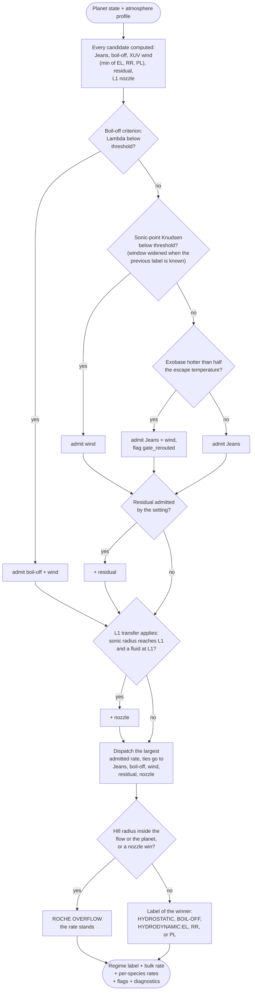

# Escape regimes

!!! info "Which entry point this section covers"
    This section describes `zephyrus.dispatch`, the escape model of ZEPHYRUS. It decides which escape physics applies to a planetary state before computing a rate. The single-prescription entry point `zephyrus.escape.EL_escape` applies the energy-limited rate to every state without that decision, and it is described on the [energy-limited escape](energy_limited.md) page.

One call to `zephyrus.dispatch` takes one planetary state and returns one verdict. The state is a set of scalars (masses, radii, orbit, stellar fluxes, the interior heat flux, a grey photospheric opacity) and an atmosphere profile given level by level from the base to the top of the modelled atmosphere: pressure, radius, temperature, species mixing ratios, and mean molecular mass. In PROTEUS the profile comes from the atmosphere model, and standalone `zephyrus.profiles.isothermal_profile` builds one. The [parameter reference](../Reference/parameters.md) lists every input and setting. The verdict is one of six regime labels (`boiloff`, `hydrodynamic:EL`, `hydrodynamic:RR`, `hydrodynamic:PL`, `hydrostatic`, `roche_overflow`), a bulk mass-loss rate $\dot{M}$, per-species rates that sum to it, flags that record every approximation the call made, and a diagnostics container reporting how close the state sat to each regime boundary. The [dispatch results reference](../Reference/results.md) lists every field.

This page gives the shared ground: where each rate is computed in the atmosphere, the notation and terms of the section, and how the dispatcher chooses one rate among several. The rate physics is on one page per regime:

- [Boil-off](regimes/boiloff.md): the bolometrically driven outflow of a loosely bound atmosphere.
- [The hydrodynamic wind](regimes/wind.md): the XUV-driven wind and its three limits, energy-limited (EL), recombination-limited (RR), and photon-limited (PL).
- [The collisionality switch](regimes/collisionality.md): whether the gas is dense enough at the wind's sonic point for a wind to exist.
- [Hydrostatic escape](regimes/hydrostatic.md): Jeans escape from the exobase, capped by diffusive resupply.
- [Roche overflow](regimes/roche.md): the tidally driven transfer through the inner Lagrange point, and the test that renames a state whose flow reaches the Roche lobe.

Equations are numbered per page, and a reference to another page names the page.

## Where each rate is computed

{ loading=lazy }
{ loading=lazy }

**Figure 1.** The levels at which each regime computes its rate, one sector per regime, built up one sector at a time (26 s, looping). Radii are not to scale, and the default settings are drawn. The interior heat flux $F_\mathrm{int}$ heats the envelope in a coupled run, where it shapes the profile and with it the photospheric level the boil-off rate reads. The default boil-off rate does not read $F_\mathrm{int}$ itself. The Roche sector draws the transfer through L1. The other reading of the `roche_overflow` label, a renamed bound flow, is not drawn. Schematic by Emma Postolec.

Four levels of the atmosphere recur on every page:

- **The photospheric working level**, at pressure $P_\mathrm{ph}$ (the setting `P_photo`, default 2000 Pa, that is, 20 mbar, the photosphere-type level of Baumeister et al. 2023 [^baumeister]). Its radius, temperature, density, and mean molecular mass are interpolated linearly in log pressure on the profile. When the profile does not span $P_\mathrm{ph}$, the nearest end level is used and the flag `photo_clamped` is raised. This one level is the XUV-absorbing radius of the energy-limited and photon-limited rates, the surface the boil-off criterion is evaluated on, the launch level of the boil-off wind, and the default launch level of the L1 transfer. Their published calibrations refer to different surfaces, so sharing one level is a simplification of the model, not a property of the physics.
- **The wind base**, radius $R_\mathrm{base}$, where XUV photons deposit their energy and the hydrodynamic wind starts, near a nanobar ([the hydrodynamic wind](regimes/wind.md), Eq. (1)).
- **The profile top**, the last level the atmosphere model supplies, at pressure $P_\mathrm{top}$ and radius $R_0$. The hydrostatic branch extends the structure upward from it.
- **The exobase**, radius $R_\mathrm{exo}$, on that extension, where the mean free path reaches the scale height ([hydrostatic escape](regimes/hydrostatic.md), Eq. (2)).

Three more radii belong to the orbit and the outflows: the sonic radius of each wind ($R_\mathrm{s}$ for the XUV wind, $R_\mathrm{B}$ for the boil-off wind), the Roche lobe $R_\mathrm{lobe}$, and the Hill radius $R_\mathrm{Hill}$. The inner Lagrange point L1 is the saddle of the combined gravitational and centrifugal potential between the planet and the star, on the line joining them, just inside the Hill radius. Gas that reaches it can pass to the star. The L1 nozzle is the narrow cross section of that saddle through which the transferred gas flows ([Roche overflow](regimes/roche.md)).

## Notation

Units are SI throughout. Mean molecular masses written $\mu$ with a level subscript are in kg per particle, while the wind mean masses $\mu_\mathrm{w}$ and $\mu_+$ are in atomic mass units and are multiplied by the proton mass $m_\mathrm{p}$ where they enter a formula. $G$ is the gravitational constant and $k_\mathrm{B}$ the Boltzmann constant. Per-species quantities carry the index $i$, and atomised elements the index $j$.

**Inputs.**

| Symbol | Meaning | Setting or input |
|---|---|---|
| $M_\mathrm{p}$, $R_\mathrm{p}$ | Planet mass and interior radius | `M_p`, `R_p` |
| $M_\star$ | Stellar mass | `M_star` |
| $a$, $e$ | Semi-major axis and eccentricity | `a`, `e` |
| $T_\mathrm{eq}$ | Equilibrium temperature | `T_eq` |
| $F_\mathrm{XUV}$ | XUV flux at the planet | `F_xuv` |
| $F_\mathrm{bol}$ | Bolometric flux at the planet | `F_bol` |
| $F_\mathrm{int}$ | Interior heat flux; $L_\mathrm{int} = 4\pi R_\mathrm{p}^2 F_\mathrm{int}$ | `F_int` |
| $\kappa$ | Grey photospheric opacity | `kappa_photo` |

**Levels and radii.**

| Symbol | Meaning | Defined in |
|---|---|---|
| $P_\mathrm{ph}$, $R_\mathrm{ph}$, $T_\mathrm{ph}$, $\rho_\mathrm{ph}$, $\mu_\mathrm{ph}$ | Photospheric working level: pressure, radius, temperature, density, mean molecular mass | [above](#where-each-rate-is-computed) |
| $R_\mathrm{XUV}$ | XUV-absorbing radius of the energy-limited and photon-limited rates, equal to $R_\mathrm{ph}$ | [The hydrodynamic wind](regimes/wind.md), Eq. (3) |
| $P_\mathrm{base}$, $R_\mathrm{base}$ | Wind base | [The hydrodynamic wind](regimes/wind.md), Eq. (1) |
| $P_\mathrm{top}$, $R_0$, $T_\mathrm{top}$ | Profile top | [above](#where-each-rate-is-computed) |
| $R_\mathrm{exo}$, $T_\mathrm{exo}$, $n_\mathrm{exo}$ | Exobase radius, temperature, number density | [Hydrostatic escape](regimes/hydrostatic.md), Eq. (2) |
| $R_\mathrm{s}$ | Sonic radius of the XUV wind | [The hydrodynamic wind](regimes/wind.md), Eq. (4) |
| $R_\mathrm{B}$ | Sonic (Bondi) radius of the boil-off wind | [Boil-off](regimes/boiloff.md), Eq. (2) |
| $R_\mathrm{Hill}$ | Hill radius at periapsis | Eq. (1) |
| $R_\mathrm{lobe}$ | Roche-lobe radius | [Roche overflow](regimes/roche.md), Eq. (2) |
| $R_\mathrm{L1}$ | Distance from the planet to L1 | [Roche overflow](regimes/roche.md), Eq. (5) |
| $R_\mathrm{flow}$ | Flow radius of the winning branch, tested against $R_\mathrm{Hill}$ | [Roche overflow](regimes/roche.md), Eq. (8) |

**Rates.** Every rate is a mass-loss rate in kg s⁻¹.

| Symbol | Meaning | Defined in |
|---|---|---|
| $\dot{M}$ | Dispatched rate | Eq. (3) |
| $\dot{M}_\mathrm{P}$ | Parker (boil-off) wind | [Boil-off](regimes/boiloff.md), Eq. (3) |
| $\dot{M}_\mathrm{B}$ | Bondi cap on the boil-off wind | [Boil-off](regimes/boiloff.md), Eq. (4) |
| $\dot{M}_\mathrm{E}$ | Interior-luminosity cap | [Boil-off](regimes/boiloff.md), Eq. (5) |
| $\dot{M}_\mathrm{bol}$ | Bolometric candidate | [Boil-off](regimes/boiloff.md), Eq. (6) |
| $\dot{M}_\mathrm{EL}$, $\dot{M}_\mathrm{RR}$, $\dot{M}_\mathrm{PL}$ | Energy-limited, recombination-limited, and photon-limited rates | [The hydrodynamic wind](regimes/wind.md), Eqs. (3), (7), (8) |
| $\dot{M}_\mathrm{hyd}$ | Hydrodynamic candidate, the smallest of the three | [The hydrodynamic wind](regimes/wind.md), Eq. (10) |
| $\dot{M}_\mathrm{hs}$ | Hydrostatic (Jeans) rate | [Hydrostatic escape](regimes/hydrostatic.md), Eq. (9) |
| $\langle\dot{M}_\mathrm{L1}\rangle$ | Transfer through L1, averaged over the orbit | [Roche overflow](regimes/roche.md), Eq. (7) |
| $\dot{M}_\mathrm{floor}$ | One proton per Julian year, $m_\mathrm{p} / (1\ \mathrm{yr})$ | [below](#the-rate-floor) |

**Criteria and parameters.**

| Symbol | Meaning | Defined in |
|---|---|---|
| $\Lambda$, $\Lambda_\mathrm{c}$ | Restricted Jeans parameter at the photospheric level, and its threshold (`lambda_crit`, default 20) | [Boil-off](regimes/boiloff.md), Eq. (1) |
| $T_\mathrm{w}$ | Wind temperature | [The hydrodynamic wind](regimes/wind.md), Eq. (2) |
| $\epsilon$ | Escape efficiency (`efficiency`, default 0.1) | [The hydrodynamic wind](regimes/wind.md), Eq. (3) |
| $\lambda_\mathrm{b}$ | Jeans parameter at the wind base | [The hydrodynamic wind](regimes/wind.md), Eq. (4) |
| $\mathrm{Kn}_\mathrm{s}$, $\mathrm{Kn}_\mathrm{c}$ | Knudsen number at the sonic point, and its threshold (`kn_crit`, default 1) | [The collisionality switch](regimes/collisionality.md), Eq. (1) |
| $\sigma_\mathrm{C}$ | Collision cross section of the gas mixture | [The collisionality switch](regimes/collisionality.md), Eq. (2) |
| $T_\mathrm{esc}$, $T_\mathrm{esc,+}$ | Neutral and plasma escape temperatures | [Hydrostatic escape](regimes/hydrostatic.md), Eq. (10) |
| $\xi$, $K$ | Hill radius over $R_\mathrm{p}$, and the tidal factor on the potential barrier | Eq. (2) |
| $\mathrm{Kn}_\mathrm{L1}$ | Knudsen number of the transferred gas at L1 | [Roche overflow](regimes/roche.md), Eq. (6) |

Symbols used on one page only are defined where they appear.

## Terms

| Term | Meaning on these pages |
|---|---|
| Candidate | One of the five rates the dispatcher can return: hydrostatic, boil-off, hydrodynamic, residual, and nozzle. Every candidate is computed at every call. |
| Admitted | Allowed into the final comparison by a condition on the state. Only admitted candidates compete. |
| Branch | The physics that produced the dispatched rate; it names the label. |
| Criterion | A test on the state that admits or excludes a candidate, such as $\Lambda < \Lambda_\mathrm{c}$. The code calls some of these gates (the `gate` setting, the `gate_rerouted` flag). |
| Band | The physically plausible range of a criterion's threshold. The diagnostics report the label at both ends of the band. |
| Clamp | Replacing a value the code cannot evaluate with the nearest one it can, and raising a flag that says so. |
| Floor | The rate of one proton per Julian year, below which a rate has no numerical content. It is reported, never applied to the dispatched rate. |
| Residual | The bolometric candidate once the boil-off criterion no longer holds. |
| Roche screen | The test, applied after the rate is chosen, that renames a state whose flow reaches beyond its Hill radius. It never changes the rate. |
| Channel | One of the two routes of mass loss in ZEPHYRUS: continuous thermal escape, which the dispatcher handles, and erosion by [giant impacts](impacts.md). |

## Tidal geometry

A close-in planet's potential barrier is lowered by the star's tidal field. Three of the rates measure that barrier, and the Roche screen tests against the Hill radius at periapsis,

$$R_\mathrm{Hill} \;=\; a\,(1 - e)\left(\frac{M_\mathrm{p}}{3\,M_\star}\right)^{1/3} \tag{1}$$

The barrier is reduced by the factor of Erkaev et al. (2007), their Eq. (17) [^erkaev],

$$K(\xi) \;=\; 1 - \frac{3}{2\xi} + \frac{1}{2\xi^3} \;=\; \frac{(\xi - 1)^2\,(2\xi + 1)}{2\xi^3}, \qquad \xi = \frac{R_\mathrm{Hill}}{R_\mathrm{p}} \tag{2}$$

with $\xi$ measured from the interior radius $R_\mathrm{p}$. That is the radius appearing linearly in the energy-limited rate, so it is the one the barrier refers to, as in Erkaev et al., whose $\xi$ is the Roche-lobe distance over the planetary radius. $K$ lies in $(0, 1)$ for $\xi > 1$ and rises toward 1 far inside the Hill sphere. The rates divide by it, so tides enhance escape. At $\xi \le 1$ the barrier is gone: the rates are then computed with $K = 1$, the flag `k_tide_undefined` is raised, and the Roche screen renames the state. Setting `tidal = False` gives $K = 1$ everywhere.

## How the rate is chosen

Every candidate is computed at every call. Three conditions on the state then decide which candidates compete:

- **The boil-off criterion**: the restricted Jeans parameter is below its threshold, $\Lambda < \Lambda_\mathrm{c}$ ([boil-off](regimes/boiloff.md), Eq. (1)).
- **A collisional wind**: the Knudsen number at the sonic point is at or below its threshold, $\mathrm{Kn}_\mathrm{s} \le \mathrm{Kn}_\mathrm{c}$ ([the collisionality switch](regimes/collisionality.md), Eq. (1)). When the previous regime label is supplied, the threshold moves by a hysteresis factor.
- **An unstable exosphere**: the exobase temperature exceeds half the escape temperature that the `gate` setting selects ([hydrostatic escape](regimes/hydrostatic.md), Eq. (10)).

| Boil-off criterion met | Wind collisional | Exosphere unstable | Admitted |
|---|---|---|---|
| yes | any | any | `boiloff`, `hydrodynamic` |
| no | yes | any | `hydrodynamic` |
| no | no | yes | `hydrostatic`, `hydrodynamic` |
| no | no | no | `hydrostatic` |

Two more candidates can join on any row: `residual` when the boil-off criterion fails and the setting `residual_mode = 'luminosity_capped'` admits it, and `nozzle` where the transfer through L1 applies on some part of the orbit ([Roche overflow](regimes/roche.md), Eqs. (5) and (6)). The dispatched rate is the largest admitted one,

$$\dot{M} \;=\; \max_{c \,\in\, \mathcal{A}} \dot{M}_c \tag{3}$$

over the admitted set $\mathcal{A}$. Ties go to the earliest of `hydrostatic`, `boiloff`, `hydrodynamic`, `residual`, and `nozzle`. The third row of the table is the exosphere stability test, and it raises the flag `gate_rerouted` whichever candidate wins.

The table is the reference for the routing. `zephyrus.dispatcher.admitted` implements it, `zephyrus.dispatcher.select` takes the maximum, and the test suite checks this table against the code. The flowchart below is drawn from the table: each diamond admits candidates, and only the box after the last diamond compares rates.

The [model overview](model.md) keeps a simpler chart that leaves out the exosphere stability test, the residual, and the nozzle.

**The label.** The label follows the candidate that carries the rate. A `hydrodynamic` win takes the wind's sub-label (`hydrodynamic:EL`, `:RR`, or `:PL`). A residual win takes the label `boiloff` with the flag `bolometric_residual`. A nozzle win takes `roche_overflow` with the transfer rate itself. Last, the Roche screen tests the flow radius of the winning branch against the Hill radius and renames an overflowing state `roche_overflow`, keeping its rate ([Roche overflow](regimes/roche.md#the-roche-screen)).

**Continuity.** Taking the maximum makes each comparison a rate crossing: the dispatched rate is continuous where one candidate overtakes another. It jumps only where a condition admits or excludes a candidate, at the boil-off criterion, the collisionality switch, the exosphere stability test, and the two conditions on the L1 transfer. Each jump is a result to measure, not an artefact to hide.

**Settings that change a candidate.** `photon_limit` and `recombination_limit` remove a term from the minimum that forms the hydrodynamic candidate and change nothing else. `residual_mode` admits the residual to Eq. (3) and never changes the bolometric candidate itself. `nozzle_temperature` chooses the launch level of the L1 transfer. `tidal = False` sets $K = 1$ in every rate.

### The rate floor

The one-proton-per-Julian-year floor $\dot{M}_\mathrm{floor} = m_\mathrm{p} / (1\ \mathrm{yr})$, about $5.3 \times 10^{-35}$ kg s⁻¹, is never applied to the dispatched rate. `diagnostics['rate_floor']` reports it and whether the dispatched rate cleared it. The module uses it in one place, a shortcut in the hydrostatic branch: a species whose Jeans rate is already below the floor skips its diffusion-supply integral, since the combined rate could only be smaller. Whether a rate above the floor matters is a separate question, which the depletion check in `diagnostics['self_consistency']` answers by comparing the time to empty the supplied reservoirs with the supplied age.

## The per-species split

The per-species rates follow the branch that produced the rate, not the label:

- A hydrodynamic rate is split by the [fractionation closure](fractionation.md) at the wind temperature and base radius, unless `fractionate = False`.
- The hydrostatic branch computes its rates species by species ([hydrostatic escape](regimes/hydrostatic.md), Eq. (9)).
- A boil-off, nozzle, or unfractionated hydrodynamic rate is split over elements in proportion to the supplied reservoir masses. When none are supplied, the mass fractions of the atomised wind-base composition are used and the flag `split_from_base_composition` is raised.

A state the Roche screen renamed keeps the split of its branch, so a wind relabelled `roche_overflow` keeps its fractionation. The per-species rates sum to $\dot{M}$ in every case.

## Boundaries are bands

Every threshold above carries a stated physical width, and the dispatcher reports that width beside every verdict instead of hiding it behind a sharp switch. The diagnostics container carries:

- the labels the state would get at the edges of the collisionality band, $\mathrm{Kn}_\mathrm{c} = 0.1$ and 3
- the boil-off band, $\Lambda_\mathrm{c} = 15$ to 35
- the transonic energy criterion of Johnson et al. (2013), their Eq. (10) [^johnson], comparing the absorbed power $\epsilon \pi R_\mathrm{XUV}^2 F_\mathrm{XUV}$ with the power needed to drive the flow sonic at all
- the Jeans-parameter triple of Guo (2024) [^guo], which translates the verdict into that classification
- both escape temperatures, with the ionisation fraction at the exobase
- the tidally corrected critical exobase temperature of Erkaev et al. (2007) [^erkaev]
- the fluid condition checked level by level below the sonic radius, after Owen & Jackson (2012) [^oj12]
- two checks on the gravitational potential $\Phi_\mathrm{G} = -G M_\mathrm{p}/R_\mathrm{p}$: the efficiency-collapse range of Caldiroli et al. (2022) [^caldiroli], and the threshold of Salz et al. (2016) [^salz], whose simulations find energy-limited escape valid below $\log_{10}(-\Phi_\mathrm{G}) = 13.11$ (with $\Phi_\mathrm{G}$ in erg g⁻¹) and hydrodynamically stable thermospheres above about 13.6. Their grid is hydrogen-dominated, so on a heavy atmosphere the check is reported as outside its scope rather than applied
- the boil-off termination timescales of Tang et al. (2024) [^tang]
- a self-consistency check: would the dispatched rate have emptied the supplied reservoirs within the supplied age
- the provenance class of every species' coefficients

The container only reports. Nothing in the routing reads it, and it has no off switch.

## Further reading

All settings and their defaults are in the [parameter reference](../Reference/parameters.md), and every field, flag, and diagnostics group of the result is in the [dispatch results reference](../Reference/results.md). The assumptions that remain on every result are collected on the [limitations page](limitations.md). The [dispatcher tutorial](../Tutorials/dispatch.md) drives the dispatcher on one planet across two regime boundaries and along a stellar history, and the [troubleshooting guide](../How-to/troubleshooting.md) starts from a flag or an unexpected verdict.

[^baumeister]: Baumeister, P., Tosi, N., Brachmann, C., Grenfell, J. L., & Noack, L. (2023). Redox state and interior structure control on the long-term habitability of stagnant-lid planets. *Astronomy & Astrophysics, 675*, A122. https://doi.org/10.1051/0004-6361/202245791

[^erkaev]: Erkaev, N. V., Kulikov, Y. N., Lammer, H., et al. (2007). Roche lobe effects on the atmospheric loss from "Hot Jupiters". *Astronomy & Astrophysics, 472*(1), 329–334. https://doi.org/10.1051/0004-6361:20066929

[^johnson]: Johnson, R. E., Volkov, A. N., & Erwin, J. T. (2013). Molecular-Kinetic Simulations of Escape from the Ex-planet and Exoplanets: Criterion for Transonic Flow. *The Astrophysical Journal Letters, 768*(1), L4. https://doi.org/10.1088/2041-8205/768/1/L4

[^guo]: Guo, J. H. (2024). Characterization of the regimes of hydrodynamic escape from low-mass exoplanets. *Nature Astronomy, 8*, 920. https://doi.org/10.1038/s41550-024-02269-w

[^oj12]: Owen, J. E., & Jackson, A. P. (2012). Planetary evaporation by UV and X-ray radiation: basic hydrodynamics. *Monthly Notices of the Royal Astronomical Society, 425*(4), 2931. https://doi.org/10.1111/j.1365-2966.2012.21481.x

[^caldiroli]: Caldiroli, A., Haardt, F., Gallo, E., Spinelli, R., Malsky, I., & Rauscher, E. (2022). Irradiation-driven escape of primordial planetary atmospheres II. Evaporation efficiency of sub-Neptunes through hot Jupiters. *Astronomy & Astrophysics, 663*, A122. https://doi.org/10.1051/0004-6361/202142763

[^salz]: Salz, M., Schneider, P. C., Czesla, S., & Schmitt, J. H. M. M. (2016). Energy-limited escape revised. The transition from strong planetary winds to stable thermospheres. *Astronomy & Astrophysics, 585*, L2. https://doi.org/10.1051/0004-6361/201527042

[^tang]: Tang, Y., et al. (2024). Assessing Core-powered Mass Loss in the Context of Early Boil-off: Minimal Long-lived Mass Loss for the Sub-Neptune Population. *The Astrophysical Journal, 976*(2), 221.
