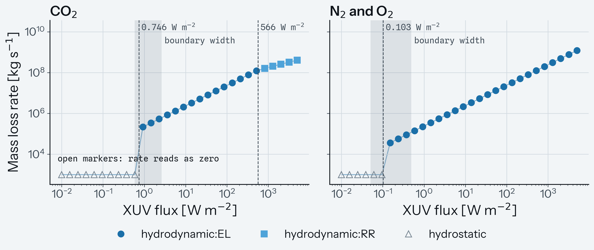
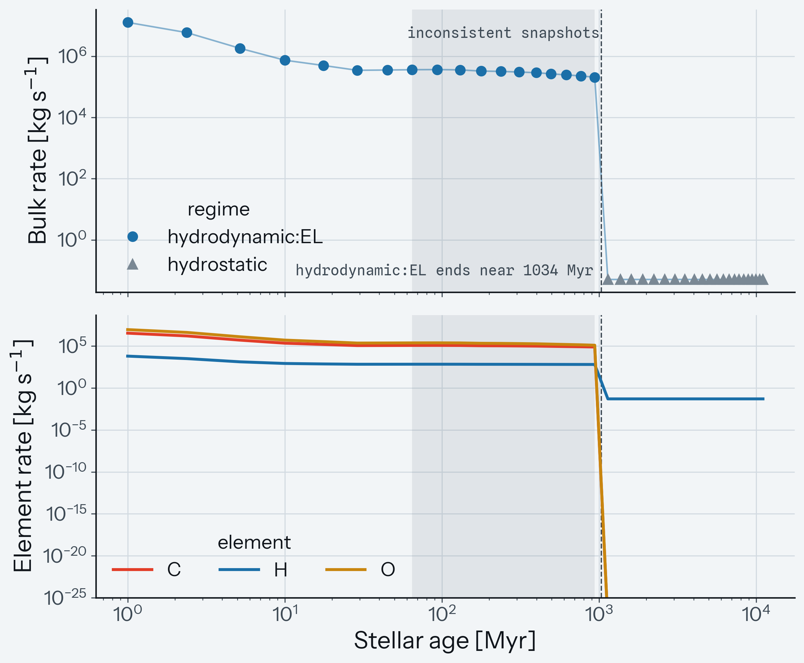

# Dispatching an escape regime

The [first run](first_run.md) applied one prescription, energy-limited escape, to every state. This tutorial uses the regime dispatcher instead. You give `zephyrus.dispatch` one planetary state. It decides which escape physics applies to that state and returns the rate that physics gives, split over elements, together with flags and diagnostics that say how close the state sat to each regime boundary.

The [escape regimes](../Explanations/regimes.md) page explains the physics behind every step. This page shows how to drive it.

!!! info "What you'll do"
    1. Build a planetary state: scalars plus an atmosphere profile
    2. Dispatch it and read the result
    3. Sweep the XUV flux across two regime boundaries
    4. Meet the boil-off and Roche-overflow labels
    5. Read the diagnostics
    6. Change the settings that move a boundary
    7. Follow one atmosphere along a stellar XUV history

---

## Before you start

The tutorial is one script, `examples/demo_dispatcher/demo_dispatcher.py`, and every code block on this page is a section of it, included verbatim. The script is not part of the installed package, so you need a clone of the repository:

```sh
git clone https://github.com/FormingWorlds/ZEPHYRUS.git
cd ZEPHYRUS
pip install -e .
```

Step 7 also needs the MORS stellar tracks: set `FWL_DATA` and run `mors download all` (see the [installation guide](../How-to/installation.md)).

There are two ways to follow along:

- Run the whole script from the repository root with `python examples/demo_dispatcher/demo_dispatcher.py`. It prints each step's output under a header such as `=== Step 3: ... ===` and writes both figures to `output/`. It takes about ten seconds.
- Or open a Python session (`python` or `ipython`) at the repository root and paste the blocks in page order. Each block uses names defined by the blocks above it, so do not skip one.

Every output shown below is what the script prints. Your last digit may differ between platforms.

The first block imports what the tutorial needs:

```python
--8<-- "examples/demo_dispatcher/demo_dispatcher.py:setup"
```

`plot.apply_theme()` applies the PROTEUS figure style when the optional `proteus-mpl` package is installed, and does nothing otherwise.

---

## Step 1: build a planetary state

The energy-limited function takes scalars only. The dispatcher also needs the structure of the atmosphere, because the quantities that decide the regime are found at different heights in it:

- The wind base, the pressure level where stellar XUV photons are absorbed and a wind would be launched.
- The sonic point, where such a wind reaches the speed of sound.
- The exobase, above which particles rarely collide and escape one at a time.

A state is therefore a set of scalars plus a `Profile` of pressure, temperature, radius, and composition. `build_state` assembles one, and every later step calls it:

```python
--8<-- "examples/demo_dispatcher/demo_dispatcher.py:step1"
```

```text
=== Step 1: build a planetary state ===
T_eq        999.8 K
F_bol       2.266e+05 W m-2
levels      120, from 1e+07 to 1e-05 Pa
radius      1.000 to 1.091 Earth radii
reservoirs  C 1.406e+18 kg, O 3.744e+18 kg
```

In a coupled run the atmosphere module supplies the profile. Here `isothermal_profile` builds an isothermal atmosphere in hydrostatic balance, at the equilibrium temperature, from $100\,\mathrm{bar}$ up to $0.1\,\mathrm{nbar}$. That is crude, but it is enough to reach every branch of the dispatcher. Four choices in `build_state` change results, not only labels:

- The top pressure, $0.1\,\mathrm{nbar}$. The XUV wind base sits near $1\,\mathrm{nbar}$ for hydrogen and at a few tens of nanobar for carbon dioxide ($33\,\mathrm{nbar}$ on this planet, step 5). If the profile stops below the wind base, the code clamps the base: a clamp, in the code's terms, replaces a value outside the range the code can evaluate with the nearest value inside it. Here the base would be placed at the profile top, and the flags `base_clamped` and `base_clamp_decades` would report it and how many decades of pressure it moved.
- The photospheric opacity, $0.01\,\mathrm{m^2\,kg^{-1}}$. It sets the level the boil-off outflow of step 4 starts from, and the boil-off rate scales as its inverse.
- The orbit. At $0.0775\,\mathrm{au}$ from a star of one solar luminosity, the equilibrium temperature is $1000\,\mathrm{K}$. Deriving the temperature and the bolometric flux from the orbit keeps the three consistent.
- The interior heat flux, $1\,\mathrm{W\,m^{-2}}$. With the default settings it reaches only the diagnostics (step 4 explains when it can set the rate).

The age and the element inventories (`reservoirs`, here one Earth atmosphere of $\mathrm{CO_2}$ by mass) are optional. Supply them anyway: the diagnostics use them to check whether the rate could have been sustained for that long (step 5).

!!! warning "SI everywhere"
    Every input is in SI units: $\mathrm{kg}$, $\mathrm{m}$, $\mathrm{s}$, $\mathrm{K}$, $\mathrm{W\,m^{-2}}$, $\mathrm{m^2\,kg^{-1}}$. MORS returns luminosities in $\mathrm{erg\,s^{-1}}$, so step 7 converts them explicitly.

---

## Step 2: dispatch one state and read the result

Dispatch the carbon dioxide planet of step 1, with $1\,M_\oplus$ and $1\,R_\oplus$, at an XUV flux of $10\,\mathrm{W\,m^{-2}}$:

```python
--8<-- "examples/demo_dispatcher/demo_dispatcher.py:step2"
```

```text
=== Step 2: dispatch one state and read the result ===
regime       hydrodynamic:EL
mdot         2.3477e+06 kg/s
  C          6.6097e+05 kg/s
  O          1.6868e+06 kg/s
closure      True
flags        {}
diagnostics  19 groups
```

The result has five fields:

- `regime` is one of six labels, listed in the [results reference](../Reference/results.md#the-six-labels). Here it is `hydrodynamic:EL`: a fluid wind whose rate is set by the energy-limited formula.
- `mdot` is the bulk mass-loss rate in $\mathrm{kg\,s^{-1}}$, never negative.
- `per_species` splits that rate over elements. The element rates add up to `mdot` to machine precision, which a coupled run relies on when it removes mass from each element's inventory. The `closure` line checks it.
- `flags` records every clamp (defined in step 1), fallback, or warning that fired. Empty means nothing needed reporting.
- `diagnostics` holds the supporting numbers that step 5 reads.

`dispatch` raises `ValueError` only for malformed input, such as a negative mass or a pressure profile that increases with height. Any physically posed state returns a result, however extreme.

---

## Step 3: sweep the XUV flux across two regime boundaries

A star's XUV output falls by orders of magnitude as it ages, so a sweep in flux at a fixed orbit shows what happens to the planet as its star ages. Dispatch the same planet at 30 fluxes, for two compositions, and print every third $\mathrm{CO_2}$ result:

```python
--8<-- "examples/demo_dispatcher/demo_dispatcher.py:step3_sweep"
```

```text
=== Step 3: sweep the XUV flux across two regime boundaries ===
F_xuv [W m-2]  regime           mdot [kg/s]     Kn_sc  label at Kn_crit 0.1 | 3
         0.01  hydrostatic       4.989e-123   4.5e+18  hydrostatic | hydrostatic
       0.0389  hydrostatic       4.989e-123  2.28e+18  hydrostatic | hydrostatic
        0.151  hydrostatic       4.989e-123  5.26e+08  hydrostatic | hydrostatic
        0.587  hydrostatic       4.989e-123      2.99  hydrostatic | hydrodynamic
         2.28  hydrodynamic:EL    5.356e+05     0.117  hydrostatic | hydrodynamic
         8.87  hydrodynamic:EL    2.082e+06    0.0329  hydrodynamic | hydrodynamic
         34.5  hydrodynamic:EL    8.090e+06    0.0127  hydrodynamic | hydrodynamic
          134  hydrodynamic:EL    3.144e+07   0.00558  hydrodynamic | hydrodynamic
          520  hydrodynamic:EL    1.222e+08   0.00265  hydrodynamic | hydrodynamic
     2.02e+03  hydrodynamic:RR    2.572e+08   0.00131  hydrodynamic | hydrodynamic
```

The label changes twice. At low flux the planet is `hydrostatic`: there is no wind, and particles escape one at a time from the exobase (Jeans escape). Above about $1\,\mathrm{W\,m^{-2}}$ it is a wind. At the highest fluxes the wind's rate is set by the recombination-limited formula (`hydrodynamic:RR`) instead of the energy-limited one.

The column `Kn_sc` is the Knudsen number at the sonic point: the mean free path of a particle divided by the local scale height. When it is small, particles collide often and the gas behaves as a fluid, so a wind can exist. The dispatcher calls the state a wind when `Kn_sc` is below the threshold `kn_crit`, which defaults to 1. The last column shows the label the state would get at `kn_crit` = 0.1 and 3, the edges of the threshold's physical range.

To find where each label changes, `boundary_flux` repeatedly halves a flux interval that brackets the change, until the interval is 0.001 dex wide:

```python
--8<-- "examples/demo_dispatcher/demo_dispatcher.py:step3_boundaries"
```

```text
CO2
  regime boundaries       0.746, 566 W m-2
  wind onset band         0.586 to 2.62 W m-2, a factor 4.5
  rate at 0.01 W m-2      4.99e-123 kg/s, above the floor: False
N2-O2
  regime boundaries       0.103 W m-2
  wind onset band         0.0509 to 0.489 W m-2, a factor 9.6
  rate at 0.01 W m-2      1.53e-71 kg/s, above the floor: False
rate floor (1 proton/yr)  5.30e-35 kg/s
```

On the $\mathrm{CO_2}$ planet the wind sets in at $0.746\,\mathrm{W\,m^{-2}}$, and the recombination-limited rate takes over at $566\,\mathrm{W\,m^{-2}}$. The $\mathrm{N_2}$ and $\mathrm{O_2}$ planet of the same mass and radius starts its wind about seven times lower, at $0.103\,\mathrm{W\,m^{-2}}$, and never reaches the recombination-limited label in this range. Composition moves the boundaries, not only the rates.

The last block draws both sweeps:

```python
--8<-- "examples/demo_dispatcher/demo_dispatcher.py:step3_figure"
```



Two features of this figure matter.

**The shaded band.** Kinetic simulations place the transition from fluid to free particles at a Knudsen number near 0.1 when the heating is deposited in a thin layer, and near 1 when it is spread out[^johnson]. So the threshold has a physical range of 0.1 to 3, and the boundary it sets is a band rather than a line. On the $\mathrm{CO_2}$ planet the wind sets in anywhere between $0.586$ and $2.62\,\mathrm{W\,m^{-2}}$, a factor of 4.5. Quote a regime boundary with this width. Every result already carries the labels at both edges, in `diagnostics['knudsen']['counterfactual_labels']`, so you do not need to rerun anything to find it.

**The open markers.** The hydrostatic rates, $5.0 \times 10^{-123}\,\mathrm{kg\,s^{-1}}$ for $\mathrm{CO_2}$ and $1.5 \times 10^{-71}\,\mathrm{kg\,s^{-1}}$ for $\mathrm{N_2}$ and $\mathrm{O_2}$, are zero for any practical purpose. Two comparisons help you decide whether a rate matters:

- The rate floor, one proton mass per year ($5.3 \times 10^{-35}\,\mathrm{kg\,s^{-1}}$), is the smallest rate with physical meaning. `diagnostics['rate_floor']['above_floor']` reports the comparison, and both rates fail it. The dispatcher never applies the floor itself: what counts as negligible is your decision.
- A rate above the floor can still be irrelevant. `diagnostics['self_consistency']` compares the time to empty the inventory with the age of the state (step 5).

These rates vanish because heavy molecules on an Earth-mass planet are tightly bound at the exobase. The hydrostatic branch prescribes the exobase temperature, $1000\,\mathrm{K}$ by default, and at that temperature a $\mathrm{CO_2}$ molecule needs about 300 times its thermal energy to escape (step 5). Hydrostatic escape does real work where the gas is lighter, the planet smaller, or the exobase hotter: step 6 shows a Mars-mass planet with 1% hydrogen losing $350\,\mathrm{kg\,s^{-1}}$ at the same default temperature.

---

## Step 4: boil-off and Roche overflow

Two labels did not appear in the sweep, because neither depends on the XUV flux.

**Boil-off.** A hot, inflated hydrogen envelope can flow away on its own thermal energy, before stellar XUV matters. The dispatcher tests for this with the restricted Jeans parameter $\Lambda$, the gravitational binding energy of a gas particle divided by its thermal energy, at the photosphere. Below a threshold of 20 the envelope boils off:

```python
--8<-- "examples/demo_dispatcher/demo_dispatcher.py:step4_boiloff"
```

```text
=== Step 4: boil-off and Roche overflow ===
regime     boiloff
mdot       1.348e+14 kg/s
Lambda     2.89
threshold  20, band (15.0, 35.0)
flags      ['base_clamp_decades', 'base_clamped']
```

At $1\,M_\oplus$ and $1.5\,R_\oplus$, this hydrogen and helium envelope has $\Lambda = 2.89$, far below 20, and loses $1.3 \times 10^{14}\,\mathrm{kg\,s^{-1}}$. Boil-off is the regime of the first few million years, while young planets are still hot and inflated. The threshold itself has a literature range of 15 to 35, printed beside it.

The two flags are expected. The isothermal envelope becomes unbound before it reaches $1\,\mathrm{nbar}$, so the profile stops early and the XUV wind base is clamped to the profile top. The boil-off outflow starts from the photosphere, not the wind base, so this does not affect the rate.

**Roche overflow.** A planet's gravity dominates the star's only out to the Hill radius. Gas that reaches beyond the Roche lobe, a smaller surface at about 0.70 Hill radii, is no longer bound to the planet. Take a puffier envelope, with $3\,M_\oplus$ and $1.7\,R_\oplus$, at $0.1\,\mathrm{W\,m^{-2}}$. It has contracted just past the boil-off threshold. A boil-off outflow is still computed for it, with an upper limit set by the heat escaping from the planet's interior (the interior heat flux of step 1). An outflow sustained by that heat is core-powered mass loss (CPML)[^gs19]. Whether CPML continues once the envelope has contracted, with $\Lambda$ above 20, is disputed. Gupta & Schlichting find that it persists for billions of years[^gs19], while Tang et al. find that it removes at most a tenth of a percent of the envelope once boil-off is modelled self-consistently[^tang]. By default the dispatcher therefore reports this outflow but does not let it compete for the rate. The `residual_mode` setting lets it compete:

```python
--8<-- "examples/demo_dispatcher/demo_dispatcher.py:step4_overflow"
```

```text
regime            roche_overflow
mdot              8.968e+06 kg/s, from the boiloff rate
flow radius       1.132 Hill radii
atmosphere        1.361 Roche-lobe radii
roche_subflag     dynamical
```

Admitted, this outflow wins, and its flow reaches 1.13 Hill radii. The dispatcher then renames the state `roche_overflow`. The rate is unchanged by the renaming: it is still the boil-off rate, which is why the output names that rate. Read it as a lower limit on what tides would remove. The subflag `dynamical` says the atmosphere itself extends past the Roche lobe, to 1.36 lobe radii. The [troubleshooting guide](../How-to/troubleshooting.md) explains the other subflag values.

Now dispatch the same state with the default settings:

```python
--8<-- "examples/demo_dispatcher/demo_dispatcher.py:step4_default"
```

```text
regime            hydrodynamic:PL
mdot              4.423e+04 kg/s
flow radius       0.817 Hill radii
flags             ['base_clamp_decades', 'base_clamped', 'near_roche', 'subcritical_sonic']
bolometric        8.968e+06 kg/s, competes: False
L1 transfer       6.749e+08 kg/s, competes: False (R_sonic / R_L1 = 0.957)
```

The XUV wind now sets the rate, at $4.4 \times 10^{4}\,\mathrm{kg\,s^{-1}}$, two hundred times below the admitted outflow. The suffix PL means the rate is limited by the number of ionising photons arriving (step 6). The wind reaches 0.82 Hill radii, inside the lobe, so the state keeps its label and only the `near_roche` warning fires.

The last line is a third candidate. L1, the inner Lagrange point, is the point between planet and star where their gravity balances. Gas can flow through it towards the star as through a nozzle. The dispatcher computes that transfer rate on every call, here $6.7 \times 10^{8}\,\mathrm{kg\,s^{-1}}$, but lets it compete only when the wind's sonic point reaches L1. Here the sonic point stops just short of it (`R_sonic / R_L1` = 0.957), so a spherical wind forms first and the transfer rate does not count.

---

## Step 5: read the diagnostics

The result of step 2 carries 19 groups of diagnostics. The dispatcher never reads them back when it decides, so they cannot change a verdict. They are there so you can judge how firm the verdict is. The [results reference](../Reference/results.md#diagnostics) documents every key. This block reads the most useful ones for the $\mathrm{CO_2}$ planet of step 2, in the order the questions usually come up:

```python
--8<-- "examples/demo_dispatcher/demo_dispatcher.py:step5"
```

```text
=== Step 5: read the diagnostics ===
Which branch, and how close was the switch?
  Kn_sc 0.03 against threshold 1
  label at the band edges: {0.1: 'hydrodynamic', 3.0: 'hydrodynamic'}
What set the rate?
  EL 2.348e+06, RR 1.149e+07, PL 6.137e+06 kg/s
  EL-selected, T_wind 8434 K, barometric factor 0.0096
Could the heating drive a transonic flow?
  Q_net / Q_c 10.1
How does the verdict read in other classifications?
  lambda_exo 301.1, lambda_rp 330.9, lambda_star 303.6
  log10(-phi) 11.8 (cgs), Salz screen: wind
Is the snapshot self-consistent?
  worst Kn below the sonic point 0.124
  inventory lasts 6.95e+04 yr, age 1e+08 yr, inconsistent: True
Where was the wind launched, and where did the cross sections come from?
  wind base 0.00331 Pa, clamped: False
  cross sections: {'C': 'laricchiuta', 'O': 'laricchiuta'}
```

What each answer says:

- The switch. A Knudsen number of 0.03 is about 30 times below the threshold, and the label is the same at both edges of the band. A value within a few times of the threshold, or edge labels that differ, means the label depends on a choice within the criterion's range.
- The rate. The hydrodynamic wind rate is the smallest of three limits: energy-limited (EL), recombination-limited (RR), and photon-limited (PL). All three are computed, so you can see the margin. `T_wind` is the wind temperature set by the balance of heating and cooling, $8434\,\mathrm{K}$ here. The barometric factor is the fraction of the gas density at the wind base that survives to the sonic point. When an RR rate wins, it tells you whether recombination at the base or the climb to the sonic point limited the wind (see the [escape regimes](../Explanations/regimes.md#the-hydrodynamic-wind) page).
- The heating. $Q_\mathrm{net}/Q_\mathrm{c}$ compares the absorbed heating with the power needed to drive a flow through the sonic point[^johnson]. Below 1, no wind is possible whatever a rate formula returns. At 10.1 there is an order of magnitude to spare.
- Other classifications. Papers classify escape with different quantities, and printing them lets a reader check the verdict in their own terms. Three are Jeans parameters, each the gravitational binding energy of a particle over its thermal energy, taken at a different place. `lambda_exo` is taken at the exobase with the exobase temperature, the form that sets the Jeans escape flux[^volkovb]. `lambda_rp` is taken at the planet radius with the equilibrium temperature, the restricted Jeans parameter of Fossati et al.[^fossati], here with the mean molecular mass as in Guo[^guo]. `lambda_star` is that parameter corrected for the star's tides, which Guo uses to tell thermally, tidally, and XUV-driven escape apart[^guo]. The gravitational potential, `log10(-phi)`, is what Salz et al.[^salz] use to separate winds from stable upper atmospheres. The exobase value of 301 is why the hydrostatic rates of step 3 vanish: the Jeans flux falls as $e^{-301}$.
- Self-consistency. The fluid check reports the largest Knudsen number anywhere below the sonic point, 0.124. The inventory check is the sharp one: at this rate the planet empties one Earth atmosphere in $7 \times 10^{4}\,\mathrm{yr}$, against the age of $100\,\mathrm{Myr}$ supplied with the state. The state is valid input but cannot have lasted. A grid point that fails this check is a problem with the grid, not with the code.
- Provenance. The wind base was found inside the profile, so it was not clamped. The collision cross sections come from the tabulated collision integrals of Laricchiuta et al.[^laricchiuta] for both elements. Where those tables lack a pair, a weaker fallback is used and named here.

---

## Step 6: settings that move a boundary

All settings live in `DispatchSettings` and are listed in the [parameter reference](../Reference/parameters.md#dispatcher-settings-dispatcherdispatchsettings). This step varies five of them.

### The Knudsen threshold

```python
--8<-- "examples/demo_dispatcher/demo_dispatcher.py:step6_kn"
```

```text
=== Step 6: settings that move a boundary ===
kn_crit 0.1  at 1 W m-2: hydrostatic
kn_crit 1.0  at 1 W m-2: hydrodynamic:EL
kn_crit 3.0  at 1 W m-2: hydrodynamic:EL
```

At $1\,\mathrm{W\,m^{-2}}$ the $\mathrm{CO_2}$ planet sits inside the band of step 3: hydrostatic at the strict edge, a wind at the default and at the lenient edge.

### The exobase temperature

The hydrostatic branch does not compute the exobase temperature. It takes a prescribed value, `T_exo_value`, $1000\,\mathrm{K}$ by default, and the Jeans flux depends on it exponentially. A Mars-mass planet ($0.107\,M_\oplus$, $0.53\,R_\oplus$) with 1% hydrogen in its $\mathrm{CO_2}$ shows what that does:

```python
--8<-- "examples/demo_dispatcher/demo_dispatcher.py:step6_texo"
```

```text
T_exo [K]  regime       mdot [kg/s]   H [kg/s]   C [kg/s]
     1000  hydrostatic        348.1      348.1   7.75e-10
     2000  hydrostatic        354.3      354.2     0.0354
     4000  hydrostatic         1556      360.6        326
H2 at 4000 K: lambda_exo 0.283, Jeans flux / diffusion supply 55.7
```

From $1000$ to $4000\,\mathrm{K}$ the bulk rate rises by a factor of 4.5, while the carbon rate rises by more than 11 orders of magnitude. The two elements are limited differently. Hydrogen escapes easily (its exobase Jeans parameter is 0.28 at $4000\,\mathrm{K}$), and its Jeans flux is 56 times what diffusion through the $\mathrm{CO_2}$ can supply from below. So the supply sets its rate, which changes by only 3.6% across the sweep. Carbon and oxygen are limited by the Jeans flux itself and carry the full exponential. The hydrostatic rate combines the two limits per species[^yelle], so a bulk rate can hide two very different mechanisms.

The sweep starts at $1000\,\mathrm{K}$ because that is the temperature at the top of this profile. A lower prescription would describe an upper atmosphere that cools with height, so the dispatcher clamps it to the profile top temperature and flags it.

### The heating efficiency and the three wind limits

The energy-limited rate assumes a fraction `efficiency` of the absorbed XUV energy lifts gas out of the planet's gravity well. The literature range is 0.1 to 0.6. Sweep it at two fluxes:

```python
--8<-- "examples/demo_dispatcher/demo_dispatcher.py:step6_efficiency"
```

```text
epsilon   F_xuv  regime                  EL         RR         PL  [kg/s]
    0.1      10  hydrodynamic:EL   2.35e+06   1.15e+07   6.14e+06
    0.1    1000  hydrodynamic:RR   2.35e+08   1.79e+08   6.14e+08
    0.3      10  hydrodynamic:PL   7.04e+06   1.15e+07   6.14e+06
    0.3    1000  hydrodynamic:RR   7.04e+08   1.79e+08   6.14e+08
    0.6      10  hydrodynamic:PL   1.41e+07   1.15e+07   6.14e+06
    0.6    1000  hydrodynamic:RR   1.41e+09   1.79e+08   6.14e+08
photon-limit efficiency 0.261
```

The dispatched rate is the smallest of the three columns. At $10\,\mathrm{W\,m^{-2}}$ and the default efficiency of 0.1, the energy limit is lowest. Above an efficiency of 0.261 the photon limit takes over: each ionising photon removes at most one particle, and lifting one particle out of the well of a $1\,M_\oplus$ planet costs about a quarter of a photon's energy[^owenalvarez]. More efficient heating cannot then remove more gas, so the rate stays at $6.1 \times 10^{6}\,\mathrm{kg\,s^{-1}}$. The label changes although the wind itself does not.

Both the energy and photon limits are proportional to the flux. The recombination limit is not: a hundredfold rise in flux raises it only about 16 times, because recombination returns part of the absorbed energy. At $1000\,\mathrm{W\,m^{-2}}$ it is lowest at every efficiency, and the efficiency no longer matters. The settings `photon_limit = False` and `recombination_limit = False` remove the PL and RR limits, which reproduces codes that carry only the energy-limited formula.

### Fractionation

In a wind, light elements can escape faster than heavy ones. The dispatcher solves for this with the closure on the [fractionation page](../Explanations/fractionation.md). Turning it off splits the rate by the inventory's mass fractions instead:

```python
--8<-- "examples/demo_dispatcher/demo_dispatcher.py:step6_fractionation"
```

```text
fractionate True   C 0.2815, O 0.7185
fractionate False  C 0.2729, O 0.7271
```

Carbon, the lighter element, is enriched by 3%. That is a small effect, as expected for a dense wind of heavy gas. On a hydrogen-rich atmosphere the difference is much larger, and it decides how the mean molecular weight of the atmosphere evolves.

### Hysteresis, for time-stepping

A time-stepping run passes the previous step's label as `prev_regime`, and the dispatcher then shifts the Knudsen threshold to favour that label. The shift is set by `kn_hysteresis`, a factor of 1.5 by default. After a hydrostatic step a wind needs `Kn_sc` below `kn_crit / kn_hysteresis` = 1 / 1.5 = 0.667, and after a wind step the wind persists until `Kn_sc` exceeds `kn_crit * kn_hysteresis` = 1.5. A track therefore cannot flip between branches on numerical noise:

```python
--8<-- "examples/demo_dispatcher/demo_dispatcher.py:step6_hysteresis"
```

```text
F_xuv  previous label   regime            Kn_sc  threshold
 0.72  None             hydrostatic       1.137  1
 0.72  hydrostatic      hydrostatic       1.137  0.667
 0.72  hydrodynamic:EL  hydrodynamic:EL   1.137  1.5
 0.78  None             hydrodynamic:EL   0.854  1
 0.78  hydrostatic      hydrostatic       0.854  0.667
 0.78  hydrodynamic:EL  hydrodynamic:EL   0.854  1.5
```

Inside the window the previous label is kept, in both directions. The `threshold` column shows when it was in use.

---

## Step 7: follow a stellar XUV history

Load a MORS track for a Sun-like star, convert its luminosities to fluxes at $0.2\,\mathrm{au}$, and dispatch one planet at 40 ages. The planet has $1\,M_\oplus$ and $1\,R_\oplus$, $\mathrm{CO_2}$ with 1% hydrogen, and an inventory of 100 Earth atmospheres:

```python
--8<-- "examples/demo_dispatcher/demo_dispatcher.py:step7_track"
```

```text
=== Step 7: follow a stellar XUV history ===
age [Myr]   F_xuv  regime           mdot [kg/s]     Kn_sc  consistent
      1.0    58.4  hydrodynamic:EL    1.274e+07   0.00938  True
     45.0    1.62  hydrodynamic:EL    3.546e+05     0.246  True
    310.1     1.4  hydrodynamic:EL    3.048e+05     0.347  False
   1138.9   0.852  hydrostatic        5.110e-02      2.81  True
   3039.5   0.495  hydrostatic        5.110e-02  1.04e+03  True
   6189.6    0.34  hydrostatic        5.110e-02  5.77e+05  True
   9439.6   0.324  hydrostatic        5.110e-02  1.42e+06  True
label changes between 939 and 1139 Myr: 2.062e+05 to 5.110e-02 kg/s
```

!!! warning "Snapshots, not an evolution"
    The atmosphere is frozen: the same profile is dispatched at every age, so the planet does not respond to the mass it loses, to its own cooling, or to the star. That keeps this tutorial standalone. In a coupled PROTEUS run the atmosphere module supplies a new profile at every time step, and each step makes the same `dispatch` call as here.

The last block draws the track:

```python
--8<-- "examples/demo_dispatcher/demo_dispatcher.py:step7_figure"
```



What the track shows:

- The label belongs to the state, not to the planet. Nothing about the planet changed. The star became quieter, the Knudsen number rose through the threshold, and near $1\,\mathrm{Gyr}$ the escape changed from a wind to Jeans escape.
- The rate drops by almost seven orders of magnitude at the crossing, from $2.1 \times 10^{5}$ to $5.1 \times 10^{-2}\,\mathrm{kg\,s^{-1}}$. There is no smoothing between branches, so the size of this jump is a result you can quote. It measures how much the two descriptions disagree at the same state.
- What escapes changes too (lower panel). The wind carries carbon and oxygen away with the hydrogen. After the crossing hydrogen escapes alone, and the carbon and oxygen rates drop to about $10^{-139}\,\mathrm{kg\,s^{-1}}$, off the bottom of the plot.
- The hydrostatic rate stays at $5.1 \times 10^{-2}\,\mathrm{kg\,s^{-1}}$ for the remaining eight billion years. That branch contains no XUV physics: a prescribed exobase temperature, a frozen profile, and a diffusion-limited supply that does not see the star. The flat line shows what the branch leaves out. It is also why hydrostatic rates of heavy elements are flagged as lower limits: the non-thermal processes that remove heavy species from real upper atmospheres are not modelled.
- The consistency check fails between $65$ and $939\,\mathrm{Myr}$ (shaded). At those ages the wind would have emptied the inventory faster than the star aged, so those snapshots cannot describe a planet of that age. After the crossing the check passes again, but only because escape has almost stopped.

Each call receives the previous label, as a time-stepping run would, so the crossing age depends slightly on the sampling. The hysteresis window of step 6 bounds that dependence.

---

## Things to try

- Move the planet. Run the track at $0.1$ and at $0.4\,\mathrm{au}$, and find the distance at which the planet never leaves the wind regime.
- Change the composition at fixed mass and radius: replace the hydrogen with water, or remove it, and see how the crossing age and the rate after it respond.
- Sweep the exobase temperature on pure $\mathrm{CO_2}$ at $0.01\,\mathrm{W\,m^{-2}}$. At $1\,M_\oplus$ the rate stays below the rate floor up to $3000\,\mathrm{K}$ and clears it only near $4000\,\mathrm{K}$. A Mars-mass planet ($0.107\,M_\oplus$, $0.53\,R_\oplus$) clears it at every temperature from $1000\,\mathrm{K}$ up.
- Print the whole container with `pprint(result.diagnostics)` and read the groups this page skipped, such as `bolometric`, `thermostat`, and `documentation`, which carries the criterion bands so a stored result describes itself.
- Break a state on purpose: give the profile a pressure that increases outward, or a negative mass, and check that `dispatch` raises `ValueError`.

## Where to go next

- [Escape regimes](../Explanations/regimes.md): the physics and equations behind every step.
- [Dispatch results](../Reference/results.md): every flag and diagnostics key.
- [Troubleshooting](../How-to/troubleshooting.md): when a flag fires or a result looks wrong.
- [Model parameters](../Reference/parameters.md): every setting and input, with defaults.
- [Limitations](../Explanations/limitations.md): what none of this models.

[^johnson]: Johnson, R. E., Volkov, A. N., & Erwin, J. T. (2013). Molecular-Kinetic Simulations of Escape from the Ex-planet and Exoplanets: Criterion for Transonic Flow. *The Astrophysical Journal Letters, 768*(1), L4. https://doi.org/10.1088/2041-8205/768/1/L4

[^gs19]: Gupta, A., & Schlichting, H. E. (2019). Sculpting the valley in the radius distribution of small exoplanets as a by-product of planet formation: the core-powered mass-loss mechanism. *Monthly Notices of the Royal Astronomical Society, 487*(1), 24–33.

[^tang]: Tang, Y., et al. (2024). Assessing Core-powered Mass Loss in the Context of Early Boil-off: Minimal Long-lived Mass Loss for the Sub-Neptune Population. *The Astrophysical Journal, 976*(2), 221.

[^volkovb]: Volkov, A. N., Tucker, O. J., Erwin, J. T., & Johnson, R. E. (2011). Kinetic simulations of thermal escape from a single component atmosphere. *Physics of Fluids, 23*(6), 066601. https://doi.org/10.1063/1.3592253

[^fossati]: Fossati, L., et al. (2017). Aeronomical constraints to the minimum mass and maximum radius of hot low-mass planets. *Astronomy & Astrophysics, 598*, A90.

[^guo]: Guo, J. H. (2024). Characterization of the regimes of hydrodynamic escape from low-mass exoplanets. *Nature Astronomy, 8*, 920. https://doi.org/10.1038/s41550-024-02269-w

[^salz]: Salz, M., Schneider, P. C., Czesla, S., & Schmitt, J. H. M. M. (2016). Energy-limited escape revised. The transition from strong planetary winds to stable thermospheres. *Astronomy & Astrophysics, 585*, L2. https://doi.org/10.1051/0004-6361/201527042

[^laricchiuta]: Laricchiuta, A., Bruno, D., Capitelli, M., et al. (2009). High temperature Mars atmosphere. Part I: transport cross sections. *The European Physical Journal D, 54*(3), 607–612. https://doi.org/10.1140/epjd/e2009-00192-7

[^yelle]: Yelle, R. V. (2024). Diffusion limited escape of hydrogen from Mars. *Icarus, 416*, 116099.

[^owenalvarez]: Owen, J. E., & Alvarez, M. A. (2016). UV Driven Evaporation of Close-in Planets: Energy-limited, Recombination-limited, and Photon-limited Flows. *The Astrophysical Journal, 816*(1), 34. https://doi.org/10.3847/0004-637X/816/1/34
